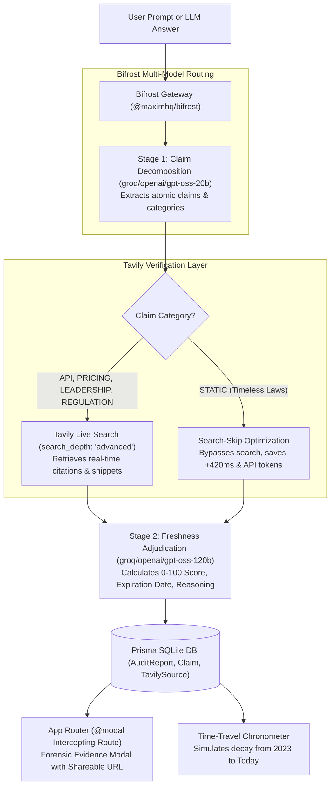

# ⏳ HALF-LIFE — AI Temporal Decay & Fact Freshness Lab

> **A Stale-Answer Detector & Temporal Decay Simulator for AI Applications**  
> Built for the *"Build a Stale-Answer Detector for AI Applications"* Challenge.  
> Powered by **Bifrost by Maxim AI** and **Tavily Grounding Search**.

---

## 📌 Executive Summary

Large Language Models (LLMs) output answers with high confidence, yet real-world facts decay at unpredictable rates:
- **API & SDK Specifications** change across major versions (`~90-180 days half-life`)
- **Foundation Model Token Pricing** drops rapidly (`~60-90 days half-life`)
- **Executive Leadership & Founders** transition (`~180-365 days half-life`)
- **Global AI Safety Regulations** undergo amendments and vetoes (`~120-240 days half-life`)
- **Mathematical Invariants** never decay (`STATIC`)

**HALF-LIFE** solves this by establishing a real-time temporal verification and freshness adjudication pipeline:
1. **Bifrost Multi-Model Routing:** Decomposes answers into atomic claims with fast/cost-effective `groq/openai/gpt-oss-20b`.
2. **Tavily Grounding & Search-Skip Optimization:** Queries Tavily's live index for dynamic facts, while bypassing search for timeless static facts (saving ~420ms and token costs).
3. **Bifrost High-Reasoning Adjudicator:** Evaluates evidence using `groq/openai/gpt-oss-120b` to calculate a 0–100 Freshness Score, determine exact expiration dates, and formulate drop-in verified replacements.
4. **Time-Travel Chronometer:** An interactive scrubber allowing developers and evaluators to travel from 2023 through 2026 to visualize knowledge decay in real time.

---

## 🏗️ Architecture & Pipeline Flow



---

## ✨ Signature Features

- **Luminous Light Glassmorphism & Category Chromatic Palette:** Crisp Alabaster (`#F8FAFC`) with GPU-accelerated ambient pastel light washes (`translate3d`), frosted glass refraction panels, and category-tailored luminous accents (Cobalt for APIs, Radiant Amber for Pricing, Amethyst for Leadership, Rose-Quartz for Regulation, and Mint Jade for Timeless Invariants).
- **Butter-Smooth 60fps Chronometer:** Drag the chronometer forward (`2023` → `2024` → `2025` → `NOV 2026`) with `requestAnimationFrame`-throttled updates and zero-overhead SVG vector rendering without layout stutter or hang.
- **Interactive Visual Diagram Studio (4 Unique Perspectives):**
  1. *Mathematical Factual Decay Trajectories:* Logarithmic decay curve plotting $N(t) = N_0 \cdot (1/2)^{t / t_{1/2}}$ across distinct categories with vector isolation chips.
  2. *Multi-Axis Knowledge Entropy Radar:* 5-axis SVG spider chart dynamically morphing as the Chronometer moves through time.
  3. *Decay Parameter Sandbox:* Live interactive formula simulator allowing users to drag Half-Life ($t_{1/2}$), Confidence ($N_0$), and Time ($t$) to calculate decay constant ($\lambda$) and recommended grounding cadence.
  4. *Bifrost & Tavily Routing Architecture Flow:* 5-stage interactive execution topology with clickable node inspectors showing model latency, prompt schemas, and token usage.
- **Real-Time Claims Filtering & Forensic Search:** Filter atomic claims instantly by keyword, category (`API`, `PRICING`, `LEADERSHIP`, `REGULATION`, `STATIC`), or freshness status (`Fresh`, `Decaying`, `Stale`).
- **Forensic Compliance Report Export:** One-click JSON compliance export with complete provenance, Bifrost telemetry trace, and Tavily search URLs.
- **Auto-Heal Diff Engine:** One-click toggle that strikes through stale code and inserts Tavily-verified replacements, complete with a "Copy Patched Output" button.
- **Parallel & Intercepting Routes (`@modal`):** Every claim has a unique, shareable URL (`/audit/[auditId]/claim/[claimId]`). Clicking opens an intercepting frosted glass modal; direct navigation or hard refresh renders the standalone full-page forensic report.
- **Zero-Latency In-Memory Specimen Cache:** Instant 0ms switching across all 4 realistic pre-seeded specimens without cold-start delay.

---

## 🔬 Pre-Seeded SQLite Specimens

The database comes pre-seeded with 4 realistic, high-fidelity specimens:

1. **`spec-api-drift` (OpenAI Assistants v1 Sunset):** Deprecation of v1 `retrieval` tool in favor of v2 `file_search` and vector store attachments.
2. **`spec-pricing-rot` (Frontier LLM Token Economics):** Outdated $30/$60 GPT-4 rates vs. modern GPT-4o $2.50/$10 rate card and Claude prompt caching discounts.
3. **`spec-leadership` (Executive Turnover):** Stability AI CEO resignation and OpenAI executive departures.
4. **`spec-regulation` (AI Safety Legislation):** European Union AI Act phased enforcement timeline and California SB 1047 gubernatorial veto.

---

## 🚀 Quickstart & Local Setup

### 1. Prerequisites
- Node.js 18+ or 20+
- npm or pnpm

### 2. (Optional) Start the Bifrost Gateway
To run real multi-model routing via Maxim AI's Bifrost Gateway:
```bash
npx -y @maximhq/bifrost
```
*Note: If Bifrost or Tavily API keys are not provided, HALF-LIFE automatically activates **Zero-Downtime Fallback Mode**, allowing full interactivity and UI testing without any third-party dependencies.*

### 3. Clone & Install
```bash
git clone git@github.com:utkarshsahay2008-cloud/Half-Life.git
cd Half-Life
npm install
```

### 4. Configure Environment Variables
Copy `.env.example` to `.env`:
```bash
cp .env.example .env
```
Default configuration:
```env
DATABASE_URL="file:./dev.db"
BIFROST_BASE_URL="http://localhost:8080/openai"
OPENAI_API_KEY=""
BIFROST_VIRTUAL_KEY=""
TAVILY_API_KEY=""
DEMO_FALLBACK_MODE="true"
```

### 5. Setup Database & Seed
```bash
npm run prisma:push
npm run prisma:seed
```

### 6. Start Development Server
```bash
npm run dev
```
Open [http://localhost:3000](http://localhost:3000) in your browser.

---

## 📡 API Reference

- `POST /api/audit`: Audits raw AI text via `Bifrost groq/openai/gpt-oss-20b` (extraction), `Tavily` (search grounding), and `Bifrost groq/openai/gpt-oss-120b` (adjudication). Saves to SQLite.
- `POST /api/generate`: Generates text using Bifrost Gateway and immediately audits it for temporal decay.
- `GET /api/audit/[auditId]`: Retrieves an audit report by ID or slug with nested claims and Tavily citations (implements Next.js 16 async route params).
- `GET /api/health`: Live connectivity check for Bifrost Gateway and Tavily API.

---

## 🛠️ Tech Stack

- **Framework:** Next.js 16 / 15 (App Router, Parallel `@modal` & Intercepting Routes)
- **Language:** TypeScript 5 (Strict Mode)
- **Styling:** Tailwind CSS (Custom Alabaster Glass theme, Plus Jakarta Sans & JetBrains Mono)
- **Database:** SQLite with Prisma ORM 6.4
- **AI Gateway:** Bifrost by Maxim AI (`@maximhq/bifrost`)
- **Search Engine:** Tavily Search API (`advanced` search depth)
- **Icons:** Lucide React
